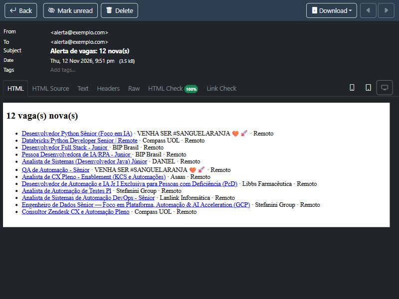

# Alerta diário de vagas com n8n

> Daily n8n workflow that searches Gupy jobs, drops scams through a FastAPI detector and e-mails a summary.

[](https://github.com/ibsondiniz/n8n-alerta-vagas/actions/workflows/ci.yml)

Todo dia às 8h, o workflow:
1. busca vagas na API pública da Gupy;
2. guarda só as vagas remotas ou em Mossoró/RN publicadas nas últimas 24 horas;
3. manda as vagas para a API do [detector-golpe-vagas](https://github.com/ibsondiniz/detector-golpe-vagas), que aponta sinais de golpe;
4. envia por e-mail as vagas aprovadas e a lista das descartadas, com o motivo.

Termos de busca, cidades e janela de tempo ficam no topo do nó **Definir buscas**. Os termos iniciais são "python", "desenvolvedor júnior", "automação" e "inteligência artificial".



*E-mail de um teste real, com a janela ampliada para 14 dias só para o print. Nas últimas 24 h havia 1 vaga nova.*

## O que sobe no Docker

| Serviço | Para quê | Endereço |
|---|---|---|
| n8n | roda o workflow | http://localhost:5678 |
| detector | API de golpe, construída direto do repositório do outro projeto | interno, porta 8000 |
| mailpit | caixa de e-mail falsa para testar sem conta real | http://localhost:8025 |

Na primeira subida, o n8n importa sozinho o workflow e uma credencial SMTP que aponta para o Mailpit.

## Como rodar

```bash
docker compose up -d
```

1. Abra http://localhost:5678 e crie o usuário administrador local do n8n.
2. Abra o workflow **Enviar alerta diário de vagas** e clique em **Execute workflow** (gatilho **Executar agora**) para testar na hora.
3. Veja o e-mail em http://localhost:8025.
4. Para deixar rodando todo dia, ative o workflow no n8n.

Também dá para rodar uma vez pela linha de comando, sem abrir o n8n. A porta extra evita conflito com o n8n que já está rodando:

```bash
docker compose exec -e N8N_RUNNERS_BROKER_PORT=5690 n8n n8n execute --id alertaVagas00001
```

### Receber no Gmail de verdade

1. Na conta Google, ative a verificação em duas etapas e gere uma **senha de app**.
2. No n8n, crie uma credencial **SMTP**:
   - host `smtp.gmail.com`;
   - porta `465`;
   - SSL/TLS ligado;
   - usuário: seu e-mail;
   - senha: a senha de app.
3. No nó **Enviar resumo por e-mail**, troque a credencial do Mailpit pela nova.
4. Copie `.env.example` para `.env`, coloque o seu e-mail em `ALERTA_EMAIL` e rode `docker compose up -d` de novo.

A senha fica guardada criptografada dentro do n8n, nunca neste repositório.

## Testes

A lógica dos nós de código é JavaScript. Os testes leem o código direto do arquivo exportado do workflow, então o que é testado é o que roda no n8n:

```bash
node --test "tests/*.test.mjs"
```

Eles verificam:
- se as ligações entre os nós estão completas;
- se o arquivo não guarda senha nem e-mail real;
- a montagem das buscas;
- o filtro de local e data, sem repetir vagas;
- o HTML do resumo, inclusive o escape de texto vindo de fora.

O GitHub Actions roda os testes e valida o `compose.yaml` a cada push.

## Como funciona

[COMO_FUNCIONA.md](COMO_FUNCIONA.md) explica cada nó e as decisões de projeto.

## Autoria

Feito por Ibson Diniz com auxílio do Claude Code, a IA de programação da Anthropic. A ideia veio da busca de vagas que eu fazia à mão todo dia; revisei e testei o workflow.

Licença [MIT](LICENSE).
